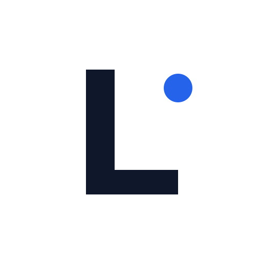
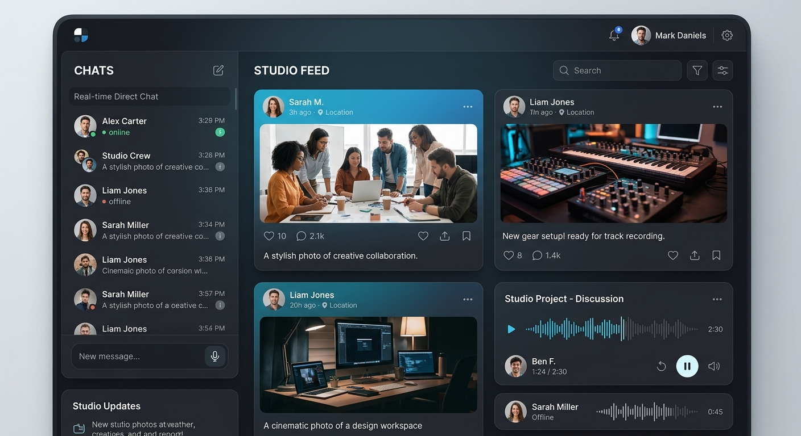

<div align="center">
  
  <h1>Looma</h1>
  <p><strong>Connect, Share, and Talk in Real Time — Edge-Powered Social Platform</strong></p>

  <p>
    
    
    
    <a href="https://github.com/PRIGID-WEB-CLOUD/Looma-/actions/workflows/ci.yml"></a>
    
    
    
  </p>
</div>

---

<div align="center">
  
</div>

---

## 1. Repository Identity

| Field | Value |
| :--- | :--- |
| **App Name** | **Looma** |
| **App Signature** | `Looma • Built by Kpormegbe Gideon (PRIGID-WEB-CLOUD)` |
| **Official Tagline** | *Connect, share, and talk in real time — built on Cloudflare Workers & Firebase.* |
| **Repository Description** | Cross-platform social media app with real-time feeds, 24-hour stories, instant & group messaging, Cloudflare Realtime Serverless SFU audio/video calls, Cloudflare R2 media storage, and Firebase Auth & Cloud Firestore. |
| **Project Website** | https://looma.prigidcollection.workers.dev/ |
| **Official Repository URL** | https://github.com/PRIGID-WEB-CLOUD/Looma- |
| **Version** | `1.0.0` |
| **Project Status** | Active & Maintained (Production on Cloudflare Workers) |

---

## 2. Ownership & Authority

| Role | Identity |
| :--- | :--- |
| **Repository Owner** | **Kpormegbe Gideon** (`PRIGID-WEB-CLOUD`) |
| **Code Owner** | **Kpormegbe Gideon** |
| **Project Maintainer** | **Kpormegbe Gideon** |
| **Lead Developer** | **Kpormegbe Gideon** |
| **Authorized Administrators** | **Kpormegbe Gideon** (`PRIGID-WEB-CLOUD`) |

All source code, UI/UX designs, brand marks, and architecture are the exclusive intellectual property of **Kpormegbe Gideon** / **PRIGID-WEB-CLOUD**.

---

## 3. Licensing & Commercial Rights

- **Proprietary License — All Rights Reserved ([LICENSE](./LICENSE))**
- **NOT FOR SALE**: This software and repository are strictly **NOT FOR SALE**.
- Commercial use, unauthorized copying, redistribution, modification, reverse engineering, or creation of derivative works is strictly prohibited without prior written permission from **Kpormegbe Gideon**.
- Looma brand marks (`/public/logo-transparent.svg`, `/public/logo-black-white.svg`, `/public/icon.svg`) are protected trademarks; third-party dependencies remain subject to their respective open-source licenses in [NOTICE](./NOTICE).

---

## 4. Core Features

1. **Social Feed & Rich Media**: Text, photo, video, audio, and link posts with categories, `#hashtags`, `@mentions`, likes, bookmarks, inline deletion, and one-click sharing to 24-hour Stories.
2. **24-Hour Stories**: Full-screen multi-frame story viewer & composer with video/image support, instant direct-message replies, and owner deletion.
3. **Direct & Group Messaging**: Real-time 1-on-1 and group chats in Firestore with admin management, online presence indicators, and unread notifications.
4. **Live Audio & Video Calls (Cloudflare Realtime Serverless SFU)**: Authenticated WebRTC audio/video calling with Firestore `/calls` membership verification, STUN/TURN ICE traversal, mute/camera/screen-share controls, incoming call ringing modal, and explicit connection/error state reporting.
5. **Cloudflare R2 Media Storage**: Authenticated uploads to `uploads/{uid}/{posts|stories|avatars}/...` with MIME and magic-byte signature verification, HTTP `206 Partial Content` byte-range streaming, and owner-verified deletion.
6. **Verified Accounts & Security**: Google Sign-In via Firebase Auth, verified-email enforcement, isolated private PII subcollections, and strict Firestore security rules.

---

## 5. Architecture Overview

- **Frontend**: React 19, Vite, Tailwind CSS v4, TypeScript (`src/App.tsx`, `src/components/`, `src/hooks/`)
- **Edge Backend**: Cloudflare Workers + Hono (`src/worker.ts`, `wrangler.jsonc`) with Workers Static Assets (`dist/`) and native `R2_BUCKET` binding (`looma`)
- **Local Dev Server**: `@hono/node-server` + Vite middleware (`server.ts`) on port `3000`
- **Database & Auth**: Firebase Auth + Cloud Firestore (`firestore.rules`, `firebase-blueprint.json`)

---

## 6. Quick Commands

```bash
# Install dependencies
bun install   # or: npm install

# Run local dev server at http://localhost:3000
npm run dev

# Typecheck
npm run lint

# Run all unit & Worker API tests
npx --yes tsx --test src/utils/*.test.ts src/services/*.test.ts src/worker.test.ts

# Production build
npm run build
```

---

## 7. Project Documentation & Governance Index

| Document | Coverage |
| :--- | :--- |
| [docs/ARCHITECTURE.md](./docs/ARCHITECTURE.md) | System, Workers, R2, and Realtime SFU Architecture |
| [docs/API.md](./docs/API.md) | Worker `/api/*` Endpoints, Auth Headers & Responses |
| [docs/DATABASE.md](./docs/DATABASE.md) | Cloud Firestore Collections & Security Invariants |
| [docs/DEVELOPMENT.md](./docs/DEVELOPMENT.md) | Installation, Setup, Configuration, Testing & Troubleshooting |
| [DEPLOYMENT.md](./DEPLOYMENT.md) | Cloudflare Workers & Firebase Deployment Guide |
| [docs/GOVERNANCE.md](./docs/GOVERNANCE.md) | Branch Rulesets, Releases, Privacy, Secret Scanning & Legal Protection |
| [CONTRIBUTING.md](./CONTRIBUTING.md) | Contribution Eligibility, Agreement, PR & Review Policy |
| [CODE_OF_CONDUCT.md](./CODE_OF_CONDUCT.md) | Community Standards & Enforcement |
| [SECURITY.md](./SECURITY.md) | Security Policy & Vulnerability Reporting |
| [SUPPORT.md](./SUPPORT.md) | Maintainer Support Channels |
| [AUTHORS.md](./AUTHORS.md) | Ownership, Maintainers & Authorized Administrators |
| [CODEOWNERS](./CODEOWNERS) | Mandatory Code Owner Approval Rules |
| [LICENSE](./LICENSE) & [NOTICE](./NOTICE) | Proprietary License (`NOT FOR SALE`) & Third-Party Notices |
| [CHANGELOG.md](./CHANGELOG.md) & [CITATION.cff](./CITATION.cff) | Version History & Repository Citation Metadata |

---

<div align="center">
  <sub>Official App Signature: <strong>Looma</strong> — Copyright © 2026 <strong>Kpormegbe Gideon</strong> (<strong>PRIGID-WEB-CLOUD</strong>). All Rights Reserved. <strong>NOT FOR SALE.</strong></sub>
</div>
